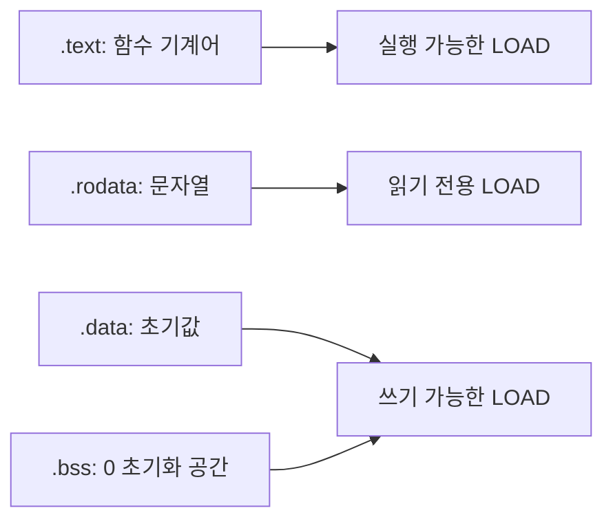

# ch 4: 함수 호출과 ELF

[이전: ch 3](ch-03.md) · [역엔지니어링 커리큘럼](curriculum.md) · [다음: ch 5](ch-05.md)

이 ch에는 `main`이 `compute`를, `compute`가 `sum_seven`을 호출하는 과정을 따라갑니다. GDB로 인자와 반환값이 어디에 놓이는지, 스택에 어떤 값이 들어가는지 확인합니다. 그런 다음 ELF 실행 파일을 열어 코드와 데이터가 파일의 어디에 저장되고, 실행할 때 메모리의 어느 주소에 놓이는지 연결해 봅니다. [실습 코드 04_elf.c](../../examples/reverse_engineering/04_elf.c)

## 1. 학습 순서와 시간

| 단계 | 시간 | 결과 |
|---|---|---|
| 호출 규약 개념 | 1시간 | 인자, 반환값, 반환 주소가 각각 어디에 놓이는지 익히기 |
| GDB 호출 실습 | 2시간 | 함수에 들어갈 때와 돌아왔을 때의 상태 기록하기 |
| ELF 조사 | 2시간 | 헤더, 섹션, 세그먼트, 심볼이 어떻게 연결되는지 확인하기 |
| 주소 계산·보고서 | 2시간 | 파일 오프셋, 정적 주소, 실행 주소를 구분해서 기록하기 |

## 2. 먼저 읽을 개념: Linux 함수 호출 규약

`compute`가 `sum_seven`을 호출할 때, 두 함수는 인자를 어디에 넣고 어디에서 읽을지 같은 규칙을 따라야 합니다. 결과를 돌려줄 위치와 호출 전후로 값을 보존할 레지스터도 정해져 있습니다. 이 규칙을 **호출 규약**이라고 합니다. 함수를 부르는 쪽은 호출자(`compute`), 불리는 쪽은 피호출자(`sum_seven`)입니다. 여기서는 **System V AMD64 ABI의 단순 정수·포인터 인자**에 적용되는 규칙을 봅니다.

| 항목 | 이번 예제의 규칙 |
|---|---|
| 첫 여섯 정수·포인터 인자 | `rdi`, `rsi`, `rdx`, `rcx`, `r8`, `r9` |
| 일곱 번째 `long` 인자 | 함수 첫 명령에서 `[rsp+8]` |
| `long` 반환값 | `rax` |
| 반환 주소 | 함수 첫 명령에서 `[rsp]` |
| 피호출자가 보존할 범용 레지스터 | `rbx`, `rbp`, `r12`~`r15`, 복귀 시 `rsp` 복원 |
| 호출로 값이 바뀔 수 있는 범용 레지스터 | `rax`, `rcx`, `rdx`, `rsi`, `rdi`, `r8`~`r11` |

`call`은 보통 자기 바로 다음 명령의 주소를 스택에 넣고, 호출할 함수의 첫 명령으로 이동합니다. 이 주소가 **반환 주소**입니다. 함수가 `ret`을 실행하면 스택에서 반환 주소를 꺼내 그 위치부터 실행을 이어갑니다. 함수가 계산해 돌려주는 **반환값**은 이 예제에서 `rax`로 전달합니다.

`rsp`는 현재 스택 맨 위의 주소입니다. 이 예제에서 `call` 직전의 `rsp`는 16의 배수입니다. `call`이 8바이트짜리 반환 주소를 스택에 넣으면 `rsp`가 8만큼 줄어듭니다. 그래서 함수에 들어온 직후에는 `rsp`를 16으로 나눈 나머지가 8입니다(`rsp % 16 == 8`). 더 큰 단위로 스택을 정렬해야 하는 인자는 이번 실습 범위 밖입니다.

32비트 `int` 인자를 읽을 때는 자료형을 확인하고 `rdi`의 하위 32비트인 `edi` 같은 레지스터를 봅니다. 이번 예제의 `long`은 기준 환경에서 64비트이므로 `rdi`처럼 레지스터 전체를 보면 됩니다. 부동소수점, 구조체, 가변 인자, 시스템 콜, Windows x64에는 별도의 규칙이 적용됩니다. [x86-64 psABI의 저수준 규칙](https://gitlab.com/x86-psABIs/x86-64-ABI/-/blob/master/x86-64-ABI/low-level-sys-info.tex)

## 3. 실습 A: 함수 첫 명령에서 상태 확인

```bash
make -C examples/reverse_engineering
./examples/reverse_engineering/build/04_elf
gdb -q ./examples/reverse_engineering/build/04_elf
```

빌드한 프로그램을 실행하면 `elf-lab result=35 zeroed[0]=28`이 출력됩니다. GDB에서는 `break *sum_seven`으로 `sum_seven`의 첫 기계어 명령에 중단점을 걸고, 함수가 스택을 바꾸기 전의 상태를 확인합니다.

```gdb
set pagination off
set disassembly-flavor intel
set disable-randomization off
break *sum_seven
run
disassemble /r sum_seven
info registers rdi rsi rdx rcx r8 r9 rsp rbp
x/2gx $rsp
print/d *(long *)($rsp + 8)
print/x ((unsigned long)$rsp & 15)
set $return_pc = *(unsigned long *)$rsp
set $entry_sp = $rsp
x/i $return_pc
bt
```

`info registers`에서 `rdi`부터 `r9`까지 표에 적힌 순서대로 1, 2, 3, 4, 5, 6을 확인합니다. `x/2gx $rsp`는 `rsp`가 가리키는 곳부터 8바이트짜리 값 두 개를 16진수로 보여줍니다. 첫 번째 값(`[rsp]`)은 반환 주소이고, 두 번째 값(`[rsp+8]`)은 일곱 번째 인자인 `7`입니다. `print/d`는 그 인자를 10진수로 읽어 보여줍니다.

`$rsp & 15`는 `rsp`를 16으로 나눈 나머지를 확인하는 식입니다. 이 시점에는 8이 나옵니다. `$return_pc`에는 반환 주소를, `$entry_sp`에는 지금의 `rsp`를 저장합니다. `x/i $return_pc`로 보면 반환 주소가 `compute`의 `call sum_seven` 바로 다음 명령을 가리킵니다. `bt`는 현재 함수까지 어떤 함수 호출을 거쳤는지 보여줍니다.

```text
높은 주소
진입 rsp + 8 : 일곱 번째 인자 7
진입 rsp     : compute로 돌아갈 반환 주소
낮은 주소     : 이후 push·지역 공간 확보에 사용할 방향
```

첫 명령에서 멈추면 GDB가 `sum_seven (a=140726437051518, b=..., g=7)`처럼 일부 인자를 잘못 보여 줄 수 있습니다. 이 `-O0` 빌드의 디버그 정보는 레지스터로 받은 인자를 `[rbp-...]`에서 읽도록 가리킵니다. 그곳에 인자를 복사하는 코드는 함수 시작 부분의 **프롤로그**에 있습니다. 첫 명령에서는 아직 새 `rbp`를 설정하거나 인자를 복사하기 전입니다. 처음부터 스택에 놓인 `g`만 맞게 보일 수 있으므로, 이 시점에는 **레지스터와 `rsp`를 기준으로 읽은 스택 값**을 기록합니다.

`break sum_seven`은 프롤로그가 끝난 뒤의 소스 줄에서 멈출 수 있습니다. 진입 시점의 `[rsp+8]`을 확인하려면 `break *sum_seven`으로 첫 명령에서 멈춥니다. 이 예제에서 `push rbp`가 이전 `rbp`를 스택에 넣으면 `rsp`가 8만큼 줄어들고, `mov rbp,rsp`는 그 주소를 새 `rbp`에 복사합니다. 일곱 번째 인자는 같은 메모리 위치에 있고, 새 기준인 `rbp`에서 보면 16바이트 위(`[rbp+16]`)에 있습니다. 실제 명령을 읽고 어떤 레지스터를 기준으로 삼았는지 적습니다.

`finish`는 현재 함수가 반환할 때까지 실행합니다. 한 번 실행해 `sum_seven`에서 `compute`로 돌아오고, 한 번 더 실행해 `compute`에서 `main`으로 돌아옵니다.

```gdb
finish
print/d $rax
print/x $pc
print $pc == $return_pc
print $rsp == $entry_sp + 8
disassemble /r compute
finish
print/d $rax
continue
quit
```

첫 `finish` 직후 `rax`에는 1부터 7까지 더한 28이 들어 있습니다. 현재 명령 주소인 `$pc`는 저장해 둔 `$return_pc`와 같아야 합니다. `ret`이 8바이트짜리 반환 주소를 꺼냈으므로 `rsp`는 진입할 때보다 8 커야 합니다. 호출자가 스택 인자에 썼던 공간을 정리하는 명령은 그다음에 실행될 수 있습니다. 두 번째 `finish` 직후에는 `compute`가 28에 전역 변수 `initialized`의 값 7을 더한 35를 반환한 상태입니다.

| 관찰 순간 | 인자 / 반환값 | PC의 의미 | 스택의 의미 |
|---|---|---|---|
| `sum_seven` 첫 명령 | 인자 1~7 | 피호출자 진입 | 반환 주소 + 스택 인자 |
| 첫 `finish` 직후 | `rax=28` | `compute`의 호출 다음 명령 | 반환 주소를 꺼낸 상태 |
| 두 번째 `finish` 직후 | `rax=35` | `main`의 호출 다음 명령 | `compute` 호출에서 복귀 |

## 4. 실습 B: ELF를 네 관점으로 읽기

`file`로 실행 파일의 형식을 확인합니다. `readelf`는 ELF 파일에 기록된 정보를 보여 줍니다. 옵션으로 ELF 헤더, 섹션, 세그먼트, 심볼 중 보고 싶은 정보를 고릅니다. 저장소 루트에서 실행합니다.

```bash
elf=examples/reverse_engineering/build/04_elf
file "$elf"
readelf -hW "$elf"
```

| 옵션 | 무엇을 보여 주는가 | `04_elf`에서 확인할 항목 |
|---|---|---|
| `-h` (`--file-header`) | ELF 헤더. 파일의 형식과 진입점을 보여 줍니다. | ELF64, little-endian, x86-64, 타입 `DYN`, `Entry point` `0x1060` |
| `-S` (`--section-headers`) | 섹션 표. 코드와 데이터가 어떻게 나뉘는지 보여 줍니다. | 이름, `Type`, `Address`, `Off`(파일 오프셋), `Size`, `Flg`. 이 빌드에서 `.rodata`는 `[18]`번입니다. |
| `-l` (`--program-headers`) | 세그먼트 표. 로더가 파일의 어느 범위를 메모리에 어떻게 배치하는지 보여 줍니다. | `LOAD`의 `Offset`, `VirtAddr`, `FileSiz`, `MemSiz`, `Flg` |
| `-s` (`--syms`) | 심볼 표. 함수나 변수의 이름, 값, 크기, 소속 섹션을 보여 줍니다. | `main`, `sum_seven`, `message`, `initialized`, `zeroed`의 `Value`, `Size`, `Ndx`. 이 빌드에서 `message`는 주소 `0x2008`, 크기 8바이트, 섹션 번호 `18`입니다. |
| `-x 섹션` (`--hex-dump=섹션`) | 지정한 섹션의 바이트를 16진수로 보여 줍니다. | `-x .rodata`로 `elf-lab`과 문자열 끝의 `00`을 확인합니다. |
| `-W` (`--wide`) | 긴 출력 행을 한 줄에 표시합니다. | `-lW`는 `-l -W`와 같으므로 `LOAD` 하나의 열을 한 줄에서 읽을 수 있습니다. |

옵션은 대소문자를 구분합니다. **대문자 `-S`는 섹션**, **소문자 `-s`는 심볼**입니다. `-l`은 소문자 L이고, 도움말은 `-H` 또는 `--help`로 엽니다. [GNU readelf 공식 문서](https://sourceware.org/binutils/docs/binutils/readelf.html)

같은 셸에서 `message`를 따라가 봅니다. 출력 숫자가 다르면 자기 빌드에서 읽은 값을 사용합니다.

```bash
readelf -sW "$elf" | awk '$NF == "message"'  # 심볼의 주소와 Ndx 확인
readelf -SW "$elf"                          # Ndx와 같은 번호의 섹션 확인
readelf -lW "$elf"                          # 심볼 주소가 들어 있는 LOAD 확인
readelf -x .rodata "$elf"                   # .rodata의 실제 바이트 확인
```

`-sW`에서 `message`의 `Ndx`가 `18`이면 `-SW`의 `[18]`번 `.rodata`와 연결합니다. `-lW`에서는 주소 `0x2008`을 포함하는 `LOAD`를 찾습니다. 범위를 계산하는 방법은 실습 D에서 다룹니다. `-x .rodata`에서 `0x2000` 행의 앞 8바이트를 지난 위치에 `65 6c 66 2d 6c 61 62 00`이 보입니다. 이 위치가 `0x2008`이고, 바이트를 문자로 읽으면 `elf-lab`과 문자열 끝을 뜻하는 `00`입니다.

섹션은 함수 기계어, 문자열, 변수의 초기값처럼 쓰임새가 비슷한 내용을 모아 둔 단위입니다.

| 섹션 | 예제 대상 | 파일의 내용 | 실행 시 의미 |
|---|---|---|---|
| `.text` | `sum_seven`, `compute`, `main` | 기계어 있음 | 보통 읽기·실행 가능 |
| `.rodata` | `message`와 출력 형식 | 바이트 있음 | 보통 읽기 전용 |
| `.data` | `initialized = 7` | 초기값 바이트 있음 | 수정 가능한 데이터 |
| `.bss` | `zeroed[4]` | `NOBITS`, 대상 데이터 바이트 없음 | 시작 시 0으로 채울 메모리 |

`.bss`에는 `zeroed`처럼 프로그램이 시작할 때 값이 0인 정적 저장 기간의 객체가 들어갈 수 있습니다. 섹션 타입 `NOBITS`는 이 섹션의 데이터 바이트가 파일에 들어 있지 않다는 뜻입니다. `.bss`에 표시된 `Size`는 실행할 때 0으로 채울 메모리 크기입니다. `Offset`도 출력에 표시되지만, `zeroed`의 초기값은 로더가 메모리에 채우므로 실행 중인 메모리에서 확인합니다. [ELF 섹션 명세](https://gabi.xinuos.com/elf/03-sheader.html)

섹션은 링커가 파일을 만들거나 사람이 파일을 분석할 때 보는 단위입니다. 세그먼트는 실행할 때 로더가 메모리에 배치하는 단위입니다. 하나의 `LOAD` 세그먼트에 여러 섹션이 들어갈 수 있습니다. `readelf -lW`의 마지막 `Section to Segment mapping`에서 각 세그먼트에 어느 섹션이 들어가는지 확인해 그려 봅니다.

`FileSiz`는 세그먼트가 파일에서 차지하는 크기이고, `MemSiz`는 메모리에서 차지하는 크기입니다. 쓰기 가능한 `LOAD`에서 `MemSiz`가 `FileSiz`보다 큰 곳을 찾습니다. 파일에 바이트가 없어도 실행할 때 확보해야 하는 공간을 `.bss`와 연결해 봅니다. [ELF 프로그램 헤더 명세](https://gabi.xinuos.com/elf/07-pheader.html)



그림은 흔히 볼 수 있는 배치입니다. 실습에서 그릴 때는 자신의 빌드 결과에 나오는 `LOAD` 개수와 섹션 포함 관계를 사용합니다.

## 5. 실습 C: ELF 진입점과 `main`

`readelf -hW`의 `Entry point`는 실행 파일에 기록된 시작 주소입니다. 이 값을 `readelf -sW`에서 `main` 심볼의 `Value`와 비교합니다. 제공 빌드는 C 런타임의 시작 코드인 `_start`를 거친 뒤 `main`을 호출하므로 두 주소가 다릅니다. 동적 링크 환경에서는 ELF 인터프리터인 동적 로더도 시작 과정에서 초기화 작업을 합니다.

```bash
objdump -d -M intel --disassemble=_start examples/reverse_engineering/build/04_elf
readelf -hW examples/reverse_engineering/build/04_elf_nopie
./examples/reverse_engineering/build/04_elf_nopie
```

PIE 빌드(`04_elf`)의 ELF 타입은 `DYN`이고, non-PIE 빌드(`04_elf_nopie`)의 타입은 `EXEC`입니다. 두 빌드의 실행 결과는 같으므로, 비교할 때는 ELF 타입과 실행 주소에 주목합니다.

## 6. 실습 D: 파일 오프셋·정적 주소·실행 주소

같은 `message`를 찾아도 파일 안에서 몇 번째 바이트인지, ELF에 어떤 주소로 기록됐는지, 실행 중 어느 주소에 놓였는지에 따라 보는 숫자가 달라집니다.

| 이름 | 기준 | 확인 도구 |
|---|---|---|
| 파일 오프셋 | 파일 시작에서 건너뛸 바이트 수. 첫 바이트는 `0` | `readelf -S`, `-l`, 파일 덤프 |
| 정적 가상 주소 | ELF에 기록된 링크 시 주소 | `readelf -s`, `objdump` |
| 실행 가상 주소 | 프로세스에 실제 매핑된 위치 | GDB의 심볼 주소, 매핑 |

### 1. `message`의 정적 가상 주소 읽기

저장소 루트에서 실행합니다. 이후 명령에서도 같은 셸의 `elf` 변수를 사용합니다.

```bash
elf=examples/reverse_engineering/build/04_elf
readelf -sW "$elf" | awk '$NF == "message" || $NF == "main"'
```

```text
    18: 0000000000002008     8 OBJECT  GLOBAL DEFAULT   18 message
    33: 00000000000011f5    80 FUNC    GLOBAL DEFAULT   16 main
```

두 번째 열인 `Value`가 ELF에 기록된 정적 가상 주소입니다. 이 빌드에서 `message`의 `Value`는 `0x2008`이고, 그 옆 `Size`는 8바이트입니다. `main`의 `Value`인 `0x11f5`는 아래 GDB 실습에서 사용합니다. 자기 빌드의 출력이 다르면 이후 명령에 자기가 읽은 값을 넣습니다.

### 2. 주소를 포함하는 `LOAD` 행 고르기

```bash
readelf -lW "$elf" | awk '$1 == "Type" || $1 == "LOAD"'
```

`readelf`는 `PT_LOAD`를 `LOAD`로 표시합니다. 이 빌드에서는 다음 행에 `message`의 주소가 들어 있습니다.

```text
Type  Offset    VirtAddr            PhysAddr            FileSiz   MemSiz    Flg Align
LOAD  0x002000  0x0000000000002000  0x0000000000002000  0x000164  0x000164  R   0x1000
```

| 출력 열 | ELF 필드 | 이 행의 값 | 의미 |
|---|---|---|---|
| `VirtAddr` | `p_vaddr` | `0x2000` | 세그먼트의 시작 정적 가상 주소 |
| `Offset` | `p_offset` | `0x2000` | 같은 세그먼트의 시작 파일 오프셋 |
| `FileSiz` | `p_filesz` | `0x164` | 세그먼트에서 파일에 저장된 바이트 수 |

`VirtAddr`부터 `FileSiz`만큼이 파일에 바이트가 있는 주소 범위입니다. `0x2164`는 범위 바로 다음 주소입니다. `.bss`처럼 메모리에만 있는 범위는 이 조건을 벗어납니다.

```text
p_vaddr <= 정적 가상 주소 < p_vaddr + p_filesz
0x2000  <= 0x2008         < 0x2000 + 0x164
0x2000  <= 0x2008         < 0x2164
```

### 3. 파일 오프셋 계산하기

`message`는 세그먼트 시작 주소에서 `0x2008 - 0x2000 = 8`바이트 뒤에 있습니다. 파일에서도 세그먼트 시작 오프셋에서 같은 거리를 이동합니다.

```text
파일 오프셋 = p_offset + (정적 가상 주소 - p_vaddr)
```

```bash
offset=$((0x2000 + (0x2008 - 0x2000)))
printf '0x%x = %d\n' "$offset" "$offset"
```

```text
0x2008 = 8200
```

이 빌드에서는 `p_offset`과 `p_vaddr`가 모두 `0x2000`이라 파일 오프셋과 정적 가상 주소가 같은 숫자로 나옵니다. 계산 연습으로 `p_offset=0x2000`, `p_vaddr=0x3000`, 대상 정적 주소가 `0x3020`이면, 세그먼트 안에서의 거리는 `0x20`, 파일 오프셋은 `0x2000 + 0x20 = 0x2020`입니다.

### 4. 파일에서 직접 바이트 읽기

`offset`에는 3단계에서 계산한 십진 정수가 들어 있습니다. `seek`로 파일 시작에서 그만큼 건너뛴 뒤 `message`의 크기인 8바이트를 읽습니다.

```bash
python3 - "$elf" "$offset" <<'PY'
import sys

with open(sys.argv[1], 'rb') as binary:
    binary.seek(int(sys.argv[2]))
    print(binary.read(8))
PY
```

```text
b'elf-lab\x00'
```

마지막 바이트 `\x00`은 C 문자열의 끝을 나타냅니다.

### GDB에서 본 실행 주소를 정적 주소로 바꾸기

GDB로 PIE 빌드를 열고 `start`로 `main`에서 멈춥니다. `&`는 심볼의 주소를, `print/x`는 그 주소를 16진수로 보여줍니다. `info proc mappings`로 실행 파일이 메모리에 놓인 범위도 확인합니다.

```bash
gdb -q "$elf"
```

```gdb
set disable-randomization off
start
print/x &main
print/x &message
print/x &initialized
print/x &zeroed
info proc mappings
```

보통의 PIE에서는 같은 실행 파일 안의 심볼이 같은 양만큼 이동해 메모리에 놓입니다. `main`의 실행 주소에서 1단계에서 읽은 `main`의 정적 주소를 빼면 이동량인 **로드 바이어스**를 구할 수 있습니다. 같은 실행 파일의 다른 심볼에도 이 값을 적용해 봅니다.

```text
로드 바이어스 = main의 실행 가상 주소 - main의 정적 가상 주소
정적 가상 주소 = 실행 가상 주소 - 로드 바이어스
```

같은 GDB 세션에서 이어서 실행합니다. 자기 빌드에서 `main`의 정적 주소가 다르면 `0x11f5`를 그 값으로 바꿉니다.

```gdb
set $bias = (unsigned long)&main - 0x11f5
print/x $bias
print/x (unsigned long)&message - $bias
x/s &message
quit
```

이 빌드에서 주소 계산 결과는 `0x2008`이고, `x/s &message`는 `"elf-lab"`을 보여줍니다. 계산한 정적 주소를 2단계의 `LOAD` 범위 확인에 쓸 수 있습니다.

프로그램을 두 번 새로 실행해 `&main`을 비교합니다. ASLR은 프로그램을 실행할 때 메모리 배치 주소를 무작위로 바꾸는 기능입니다. ASLR이 적용되면 PIE의 `&main`이 실행마다 달라질 수 있습니다. 주소가 같다면 시스템의 ASLR 설정과 GDB 설정을 확인하고 관찰한 값을 적습니다. non-PIE 빌드인 `04_elf_nopie`에서도 실행을 반복해 `&main`을 비교합니다. 주 실행 파일의 주소가 고정돼 있어도 스택과 라이브러리 주소는 달라질 수 있습니다.

## 7. 수정 과제와 제출물

1. `sum_seven`을 호출할 때 넘기는 마지막 인자를 7에서 70으로 바꿉니다. 일곱 번째 인자가 놓인 자리에서 70을 읽고, `sum_seven`이 91을, `compute`가 98을 반환하는지 확인합니다.
2. `zeroed[4]`를 `zeroed[1024]`로 바꿉니다. `.bss`의 크기와 그 섹션을 담은 `LOAD`의 `MemSiz`가 얼마나 늘었는지 확인합니다. 파일 전체 크기는 정렬이나 메타데이터도 영향을 주므로 실제로 관찰한 값을 적습니다.
3. `message`의 실제 파일 오프셋을 계산합니다. 그 위치에서 읽은 파일 바이트를 GDB에서 `x/s &message`로 확인한 문자열과 비교합니다.

보고서에 다음 내용을 담습니다.

- `sum_seven`의 첫 명령, 첫 `finish` 직후, 두 번째 `finish` 직후의 호출 상태표
- `.text`, `.rodata`, `.data`, `.bss`의 심볼, 주소, 오프셋, 크기 지도
- 각 섹션이 어느 세그먼트에 들어가는지 보여주는 대응 관계
- `message`의 주소에서 파일 오프셋을 구한 계산 과정
- PIE와 non-PIE 비교 결과

제출 전에 아래 질문에 답할 수 있는지 확인합니다.

- 반환값과 반환 주소를 각각 다른 장소에서 관찰했는가?
- 일곱 번째 인자의 위치를 프롤로그 실행 전후로 구분했는가?
- `.bss`가 메모리를 차지하면서 파일에 해당 데이터 바이트가 없는 이유를 설명할 수 있는가?
- ELF 진입점과 `main`, 파일 오프셋과 실행 주소를 구분할 수 있는가?

다른 사람이 보고서에 적힌 명령을 따라 했을 때 같은 값의 관계와 바이트를 확인할 수 있으면 실습을 마친 것입니다. 다음 ch에는 여기서 확인한 내용을 Ghidra의 함수, 참조, 디컴파일 결과와 연결합니다. [ch 5](ch-05.md)
