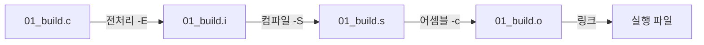

# 1주차: C와 빌드 흐름

[12주 커리큘럼](../reverse-engineering.md) · [다음: 2주차](week-02.md)

이번 주 목표는 C의 입력·출력·분기·배열·함수를 읽고, **소스·어셈블리·오브젝트·실행 파일의 차이**를 설명하는 것입니다. 소스는 [01_build.c](../../examples/reverse_engineering/01_build.c)입니다.

## 0. 과정 시작 전 준비

1~8주차 자료의 명령은 별도 표시가 없으면 **저장소 루트**에서 실행합니다. 기준 환경은 x86-64 Linux 또는 WSL2입니다. ARM 머신은 x86-64 Linux 가상 머신을 사용합니다.

```bash
uname -m
gcc --version
gdb --version
readelf --version
python3 --version
make -C examples/reverse_engineering
python3 -m unittest tests.test_reverse_engineering -v
```

`uname -m`은 `x86_64`여야 합니다. 도구가 없으면 Ubuntu/Debian 실습 머신에서 `sudo apt install build-essential binutils file gdb python3`로 설치합니다. Ghidra는 5주차 전에 [공식 설치 안내](https://github.com/NationalSecurityAgency/ghidra#install)대로 준비합니다.

빌드 결과는 `examples/reverse_engineering/build/`에 생깁니다. 기본 옵션 `-O0 -g -fno-omit-frame-pointer -fPIE -pie`는 최적화를 줄이고 디버그 정보를 남기면서 PIE 주소 변화를 관찰하기 위한 설정입니다. 4주차에는 non-PIE 비교본, 5·7주차에는 심볼을 지운 `_stripped` 사본을 함께 만듭니다. 자동 테스트는 빌드·동작·ELF 속성만 확인하며, GDB·Ghidra 관찰은 각 주차 절차로 직접 수행합니다.

매주 같은 양식으로 보고서를 남깁니다. 개인 기록은 Git에서 제외된 `notes/private/`에 둘 수 있습니다.

```text
주차 / 날짜:
환경: OS, uname -m, GCC·Binutils·GDB(·Ghidra) 버전
대상: 소스 경로, 빌드 명령, 실행 파일 SHA-256 (sha256sum 결과)
분석 질문 / 실행 전 예측:
재현 절차: 터미널 명령과 GDB 명령을 구분
관찰: 입력, 출력, 종료 코드, 주소, 바이트, 레지스터
해석: 관찰이 가설을 지지하거나 반박한 이유
미확인: 아직 확인하지 못한 조건과 다음 확인 방법
수정 과제: 변경 내용과 정상·오류·경계 입력 결과
```

막혔을 때 먼저 확인할 것:

| 증상 | 확인과 해결 |
|---|---|
| `Exec format error` | `uname -m`과 `file 실행파일`을 비교하고 x86-64 Linux에서 재빌드 |
| `No debugging symbols found` | 제공 Makefile로 다시 빌드하고 `build/`의 디버그 실행 파일(이름에 `_stripped`가 없는 것) 열기 |
| GDB에서 지역 변수·인자가 이상함 | 함수 첫 명령인지, 초기화가 끝난 줄인지 확인. `bt`, `frame`, `info locals` 사용 |
| `ptrace: Operation not permitted` | 컨테이너·샌드박스의 디버깅 제한. ptrace가 허용된 개인 실습 VM에서 진행 |
| 주소가 문서와 다름 | 정상입니다. 자신의 `disassemble`, `print/x &변수`, `info proc mappings` 결과로 기록 |
| 소스를 바꿨는데 결과가 같음 | `make -C examples/reverse_engineering` 후 실행 파일 경로와 수정 시간 확인 |

GDB에 입력할 명령은 `gdb` 코드 블록으로 표시합니다. `$rax` 같은 표기는 GDB 안에서 해석되므로 셸에 붙여 넣지 않습니다.

## 1. 학습 순서와 시간

| 단계 | 시간 | 끝나면 할 수 있는 일 |
|---|---|---|
| 개념 | 1.5시간 | 정수·배열·문자열·함수와 종료 코드 설명 |
| 실행 관찰 | 1시간 | 정상·실패·잘못된 사용을 구분 |
| 빌드 단계 실습 | 2시간 | `.i`, `.s`, `.o`, 실행 파일 생성·비교 |
| 수정·보고서 | 2시간 | 가설 하나를 코드 변경으로 검증 |

## 2. 먼저 읽을 개념

`main(int argc, char **argv)`의 `argc`는 실행 이름을 포함한 인자 개수입니다. `./01_build trace`에서 `argc`는 2, `argv[1]`은 문자열 `trace`입니다. `return 0`은 성공, 이 예제의 1은 판정 실패, 2는 잘못된 사용을 나타냅니다. 종료 코드의 구체적 의미는 프로그램이 정합니다.

함수 `sum_scores`는 배열의 첫 원소 주소와 원소 개수를 받습니다. C의 배열 인자가 자동으로 길이를 전달하지 않으므로 `count`가 필요합니다. 반복문에서 `index < count`를 유지하며, 이번 고정 점수의 합 240은 `int` 범위 안입니다.

| 표현 | 의미 | 예제 값 |
|---|---|---|
| `int negative = -1` | 부호 있는 정수 | -1 |
| `(unsigned int)negative` | unsigned 정수로 변환 | `UINT_MAX` |
| `char text[text_size]` | 입력 문자열을 담는 수정 가능한 가변 길이 배열 | 입력 길이 + 1바이트 |
| `sizeof text` | 배열 전체 저장 크기(NUL 포함) | `trace` 입력이면 6 |
| `strlen(text)` | 첫 NUL 이전 바이트 수 | 5 |
| `strcmp(input, "trace") == 0` | 두 문자열 내용이 동일 | 같으면 참 |

`sizeof`의 결과형은 `size_t`이며 출력 형식은 `%zu`입니다. 이번 배열에는 고정된 ASCII만 사용하므로 바이트 수와 글자 수가 같습니다. UTF-8 문자열에서는 `strlen`을 화면의 글자 수로 해석하지 않습니다.

부호 있는 비교 `-1 < 1`은 참이지만, `-1`을 `unsigned int`로 변환한 값은 1보다 큽니다. unsigned 변환·연산은 해당 자료형 범위에 맞춘 모듈러 규칙을 따릅니다. 반면 signed 정수 오버플로를 같은 규칙으로 가정하면 안 됩니다. 이 예제는 비교 전에 명시적으로 변환해 두 경우를 분리합니다.

## 3. 실습 A: 입력·출력·종료 코드

저장소 루트에서 빌드하고 실행합니다.

```bash
make -C examples/reverse_engineering
./examples/reverse_engineering/build/01_build trace
echo $?
```

기대 출력과 종료 코드:

```text
count=3 total=240 grade=B
text=trace bytes=6 length=5
signed_less=1 unsigned_less=0
accepted
0
```

이제 **실행 전에** 결과를 표에 예측하고 확인합니다.

```bash
./examples/reverse_engineering/build/01_build wrong
echo $?
./examples/reverse_engineering/build/01_build trac
echo $?
./examples/reverse_engineering/build/01_build traceX
echo $?
./examples/reverse_engineering/build/01_build ''
echo $?
./examples/reverse_engineering/build/01_build
echo $?
```

| 입력 | 마지막 표준 출력 | 종료 코드 | 이유 |
|---|---|---|---|
| `trace` | `accepted` | 0 | 길이와 내용 일치 |
| `wrong` | `rejected` | 1 | 길이는 같고 내용이 다름 |
| `trac`, `traceX`, 빈 문자열 | `rejected` | 1 | 길이가 다름 |
| 인자 없음 또는 인자 2개 이상 | 표준 출력 없음 | 2 | 사용법은 표준 오류로 출력 |

잘못된 사용이 아니면 앞의 세 정보 줄은 동일합니다. `check`에서 길이 검사를 통과한 경우에만 `strcmp`에 도달하는 경로를 소스에 표시합니다. `grade_for`의 `switch`에서 평균 80이 왜 B가 되는지도 설명합니다.

## 4. 실습 B: 빌드 단계를 분리하기

다음 그림에서 각 화살표는 서로 다른 작업입니다.



Makefile이 생성한 파일을 조사합니다.

```bash
file examples/reverse_engineering/build/01_build*
less examples/reverse_engineering/build/01_build.i
less examples/reverse_engineering/build/01_build.s
readelf -h examples/reverse_engineering/build/01_build.o
readelf -h examples/reverse_engineering/build/01_build
readelf -sW examples/reverse_engineering/build/01_build.o
readelf -rW examples/reverse_engineering/build/01_build.o
```

`less`는 `q`로 닫습니다. `.i`에서는 헤더 선언과 전처리 흔적, `.s`에서는 `sum_scores`, `check` 같은 레이블을 찾습니다. `.o`는 기계어를 포함하지만 외부 함수 참조 등을 해결할 링크 작업이 남아 있습니다. `readelf -sW`의 `UND` 항목과 `-rW`의 재배치 항목이 그 단서입니다. 최종 동적 링크 실행 파일에도 런타임에 해결할 외부 심볼과 재배치가 남을 수 있습니다.

| 산출물 | 읽는 방법 | 확인할 점 |
|---|---|---|
| `.i` | 텍스트 | `#include`로 들어온 선언, 전처리 후 코드 |
| `.s` | 텍스트 | Intel 문법 명령어, 레이블, 데이터 지시어 |
| `.o` | `file`, `readelf`, `objdump` | ELF `REL`, 기계어·심볼·재배치, 바로 실행할 프로그램은 아님 |
| `01_build` | 같은 도구 및 직접 실행 | 이번 PIE 빌드는 ELF `DYN`, 로딩에 필요한 정보 포함 |

`DYN`만으로 모든 ELF를 PIE라고 판정하지 않습니다. 공유 라이브러리도 이 타입을 사용합니다. 여기서는 빌드 옵션과 `file` 결과를 함께 확인합니다. 빌드 중단 옵션의 정의는 [GCC 공식 문서](https://gcc.gnu.org/onlinedocs/gcc/Overall-Options.html)를 참고합니다.

다음은 `.o`를 직접 링크한 비교본입니다. 원본 빌드는 유지합니다.

```bash
gcc -pie examples/reverse_engineering/build/01_build.o \
  -o examples/reverse_engineering/build/01_linked
./examples/reverse_engineering/build/01_linked trace
echo $?
strings -a examples/reverse_engineering/build/01_build
objdump -d -M intel --disassemble=check examples/reverse_engineering/build/01_build
```

직접 링크한 버전도 같은 성공 출력을 내야 합니다. `strings`에 있는 `trace`, `accepted`가 데이터라는 점을 확인합니다. 문자열이 존재한다는 사실만으로 판정 로직을 다 설명한 것은 아니므로 소스의 사용 지점과 연결합니다. 디스어셈블의 명령을 모두 읽는 것은 3주차 목표입니다.

## 5. 수정 과제

1. `text`를 `char text[12] = "trace";`로 바꾸고 `sizeof`와 `strlen`의 변화를 예측합니다. 기대값은 12와 5입니다.
2. 점수 배열을 `{60, 70, 80}`으로 바꿉니다. 합 210·평균 70·등급 C를 확인합니다.
3. `check`가 `trace` 또는 `learn`을 수락하게 바꿉니다. 성공 2개, 같은 길이 실패 1개, 길이 경계 4·6, 빈 문자열을 비교합니다.

각 변경을 따로 적용해 어느 변경이 출력 차이를 만들었는지 확인합니다. 빌드 후 원래 예제에 대한 자동 테스트가 실패하면 수정 과제의 새 규칙과 원래 기대값을 구분해 기록합니다.

## 6. 제출물과 자가 점검

제출물은 빌드 단계 그림, 다섯 종류 이상의 입력 결과, 산출물 비교표, 수정 전후 관찰입니다. 표에는 명령·표준 출력·표준 오류·종료 코드를 적습니다.

- `.o`에 기계어가 있는데도 링크가 필요한 이유를 설명할 수 있는가?
- `sizeof text`와 `strlen(text)`가 다른 이유를 NUL까지 그려 설명할 수 있는가?
- 배열 원소 수와 함수로 전달한 포인터 크기를 혼동하지 않는가?
- 판정 실패와 잘못된 사용을 종료 코드로 구분할 수 있는가?

**확인 답**

1. `.o`에는 함수의 기계어가 있지만, 다른 파일이나 라이브러리에 있는 함수의 주소는 아직 정해지지 않았을 수 있습니다. 링크 단계에서 링커가 오브젝트와 라이브러리를 결합하고, 심볼을 연결하며, 재배치 정보를 적용해 실행 파일을 만듭니다.
2. `trace` 문자열은 메모리에 `t r a c e \0`으로 저장됩니다. `strlen(text)`는 NUL 앞의 문자 수인 5를 반환하고, `sizeof text`는 NUL까지 포함한 배열 크기인 6을 반환합니다.
3. 배열을 함수 인자로 전달하면 보통 첫 원소를 가리키는 포인터로 변환됩니다. 따라서 `sum_scores`의 `scores`는 배열 전체가 아니라 첫 `int`의 주소이고, 원소 수는 별도 인자 `count`로 전달합니다. 함수 안에서 `sizeof scores`를 해도 원소 수가 아니라 포인터 크기입니다.
4. 이 예제에서 입력 판정 성공은 종료 코드 `0`, 판정 실패는 `1`, 인자 개수가 잘못된 사용은 사용법을 표준 오류에 출력하고 `2`를 반환합니다. `0`은 보통 성공을 뜻하는 관례지만, `1`과 `2`의 구체적인 의미는 프로그램이 정합니다. 실행 직후 셸에서 `echo $?`를 입력하면 종료 코드를 확인할 수 있습니다.

1주차에서는 `check`의 입력과 반환값, 그리고 위 빌드·자료형 개념을 설명할 수 있으면 다음 단계로 넘어갑니다.
