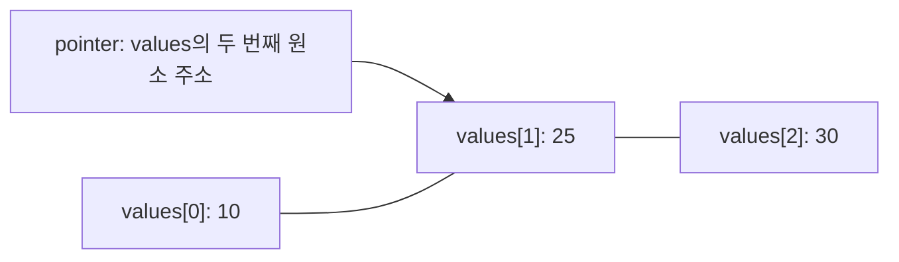

# 2주차: 포인터와 프로세스 메모리

[이전: 1주차](week-01.md) · [12주 커리큘럼](../reverse-engineering.md) · [다음: 3주차](week-03.md)

이번 주 목표는 **값·주소·그 주소의 바이트·객체 수명**을 따로 설명하는 것입니다. [02_memory.c](../../examples/reverse_engineering/02_memory.c)를 읽고 GDB로 관찰합니다. 분석을 위해 배열 경계를 넘거나 해제된 공간을 읽을 필요는 없습니다.

## 1. 학습 순서와 시간

| 단계 | 시간 | 결과 |
|---|---|---|
| 포인터·수명 개념 | 1.5시간 | `p`, `*p`, `&p`와 배열·포인터 차이 설명 |
| 출력·주소 관찰 | 1시간 | 어떤 값이 어디에 저장되는지 예측 |
| GDB·구조체 실습 | 2.5시간 | 바이트 순서·필드 배치·동적 할당 관찰 |
| 수정·보고서 | 2시간 | 메모리 그림과 객체 수명 표 작성 |

## 2. 먼저 읽을 개념

```c
int values[] = {10, 20, 30};
int *pointer = &values[1];
*pointer = 25;
```

`pointer`는 두 번째 원소의 주소를 값으로 갖는 별도 객체입니다. `*pointer`는 그 주소의 `int` 객체를 가리키므로 대입하면 `values[1]`이 25가 됩니다. `&pointer`는 포인터 변수 자체의 주소입니다. 포인터 주소와 포인터가 가리키는 주소는 구분해야 합니다.



이 과정의 LP64 Linux x86-64에서는 보통 `sizeof(int) == 4`, `sizeof(void *) == 8`입니다. 실제 출력으로 확인합니다. `values + 1`은 1바이트가 아니라 `int` 원소 하나만큼 이동합니다. 선언된 배열의 범위에서만 역참조하며, 배열 끝 바로 다음 주소는 계산할 수 있어도 역참조하지 않습니다.

| 객체 | 수명과 성질 | 흔히 관찰하는 위치 |
|---|---|---|
| 전역 `global_count` | 프로그램 실행 동안 존재, 수정 가능 | 실행 파일의 쓰기 가능한 매핑 |
| 전역 `banner`·문자열 리터럴 | 실행 동안 존재, 리터럴 수정은 허용되지 않음 | 읽기 전용 데이터 매핑 |
| `main`의 `word`, `values`, `record`, `pointer` | 해당 블록이 끝날 때 수명 종료 | 이번 디버그 빌드에서는 주로 스택 |
| `malloc`으로 얻은 원소 3개 | 할당 성공부터 `free`까지 | 힙 또는 할당기가 사용하는 별도 매핑 |

저장 기간은 C 객체의 규칙이고 스택·매핑은 구현을 관찰한 결과입니다. 최적화하면 지역 변수가 레지스터에만 있거나 사라질 수도 있습니다. `malloc`이 언제나 `[heap]`이라는 이름의 매핑을 사용한다고 가정하지 않습니다.

## 3. 실습 A: 주소보다 값의 관계를 먼저 예측하기

```bash
make -C examples/reverse_engineering
./examples/reverse_engineering/build/02_memory
```

기준 환경의 출력에서 주소를 제외한 부분은 다음과 같습니다.

```text
array_bytes=12 pointer_bytes=8 literal_length=5
record_bytes=12 offsets=0,4,8
word=12345678 middle=25 record=R/3/5
heap=20,50,60 literal=trace global=7
addresses: word=... values=... record=... heap=... literal=... global=...
heap released
```

원소 변경이 동적 배열의 `20,50,60`과 어떻게 연결되는지 설명합니다. 주소는 실행마다 달라질 수 있습니다. 구조체 크기와 오프셋도 해당 컴파일 환경의 관찰값으로 기록합니다.

## 4. 실습 B: GDB에서 주소와 바이트 읽기

```bash
gdb -q ./examples/reverse_engineering/build/02_memory
```

아래는 GDB 명령입니다. `inspect_memory`는 모든 객체를 초기화한 뒤 호출하므로 첫 관찰 지점으로 사용합니다.

```gdb
set pagination off
set disassembly-flavor intel
set disable-randomization off
break inspect_memory
run
bt
print/x *word
print/x word
x/4bx word
print values[1]
x/3dw values
print *record
print record->count
x/3dw heap
x/s literal
info proc mappings
```

`set disable-randomization off`는 GDB가 ASLR을 끄지 않도록 합니다. 이 설정은 분석에 필수는 아니며, 주소 변화가 자연스럽게 보이도록 사용합니다.

| 명령 | 읽는 대상 | 기대 결과 |
|---|---|---|
| `print/x *word` | 포인터가 가리키는 정수 값 | `0x12345678` |
| `print/x word` | 포인터에 저장된 주소 | 실행 시 정해지는 주소 |
| `x/4bx word` | 주소에서 시작하는 1바이트 단위 4개 | `0x78 0x56 0x34 0x12` |
| `x/3dw values` | 4바이트 단위 signed 정수 3개 | `10 25 30` |
| `x/s literal` | NUL로 끝나는 문자열 | `"trace"` |

Little-endian에서는 정수의 하위 바이트가 낮은 주소에 놓입니다. 그래서 `0x12345678`의 첫 메모리 바이트는 `0x78`입니다. **정수의 값이 뒤집힌 것**이 아니라 값을 저장하는 바이트 순서의 차이입니다. `x/nfu`의 `n`은 개수, `f`는 표시 형식, `u`는 단위 크기이며 정의는 [GDB 메모리 검사 문서](https://sourceware.org/gdb/current/onlinedocs/gdb.html/Memory.html)를 참고합니다.

호출자의 지역 변수도 확인합니다.

```gdb
up
print pointer
print *pointer
print &pointer
print &values[1]
print sizeof(values)
print sizeof(pointer)
print &values[1] - &values[0]
down
print sizeof(values)
```

`up`은 호출자의 프레임, `down`은 다시 호출된 함수의 프레임을 선택합니다. `main`에서 `sizeof(values)`는 12, `sizeof(pointer)`는 8입니다. 두 원소 포인터의 차는 **원소 개수**인 1입니다. `inspect_memory`의 `values`는 포인터 매개변수이므로 마지막 크기는 8입니다. 같은 이름이어도 선택한 프레임의 자료형이 다릅니다.

## 5. 실습 C: 구조체와 패딩

예제 구조체는 다음 순서입니다.

```c
struct Record {
    char tag;
    int count;
    short flags;
};
```

GDB에서 `inspect_memory` 프레임을 선택한 상태로 실행합니다.

```gdb
ptype /o struct Record
print sizeof(struct Record)
print &record->tag
print &record->count
print &record->flags
```

`print &record->tag`는 `0x... "R"`처럼 주소 뒤에 문자열을 덧붙여 보여 줍니다. 자료형이 `char *`이면 GDB가 그 주소부터 NUL까지를 문자열로 읽어 표시하기 때문입니다. `tag`는 문자 하나일 뿐 문자열이 아니며, 뒤따르는 바이트는 패딩이나 다른 필드입니다. 주소만 보려면 `print (void *)&record->tag`를 사용합니다.

기준 환경의 배치는 다음과 같습니다. `offsetof`의 출력과 대조합니다.

| 오프셋 | 크기 | 내용 |
|---|---|---|
| 0 | 1 | `tag` |
| 1~3 | 3 | 내부 패딩 |
| 4 | 4 | `count` |
| 8 | 2 | `flags` |
| 10~11 | 2 | 꼬리 패딩 |

필드 크기의 합 7과 전체 크기 12가 다릅니다. 패딩은 필드 정렬과 구조체 배열 배치를 위한 공간입니다. 패딩 바이트의 값은 프로그램의 데이터 의미로 해석하거나 고정값으로 기대하지 않습니다. 필드 순서를 바꾸어도 같은 크기가 나올 수 있으므로 직접 측정합니다.

## 6. 실습 D: 해제 지점을 기준으로 수명 설명하기

지금까지 `heap`은 초기화가 끝났고 아직 해제되지 않은 공간을 가리켰습니다. 이제 호출이 끝나는 위치로 돌아가 소스를 살펴봅니다.

```gdb
finish
list
```

`list`와 `next`로 `free(heap)` 직전까지 이동합니다. `next`는 소스 줄 단위로 진행하므로 현재 표시된 줄이 아직 실행 전인지 확인합니다. 해제 전 마지막으로 `x/3dw heap`을 기록한 뒤 `free`와 `heap = NULL`을 넘깁니다. 해제 후에는 메모리를 읽지 말고 `print heap`으로 변수에 저장된 값만 확인합니다.

```gdb
continue
quit
```

`free`는 할당한 공간의 수명을 끝냅니다. `heap = NULL`은 이 포인터 변수만 바꾸며, 복사해 둔 다른 포인터까지 NULL로 바꾸지 않습니다. 지역 포인터 변수가 함수를 벗어났다는 이유로 할당 공간이 자동 해제되는 것도 아닙니다.

## 7. 수정 과제와 제출물

1. `pointer`가 `values[2]`를 가리키게 하고 35를 저장합니다. 원본 배열과 동적 배열의 기대값을 먼저 적고 확인합니다.
2. 구조체 순서를 `char`, `short`, `int`로 바꿉니다. 기준 ABI에서 크기 8, 오프셋 0·2·4가 되는지 `offsetof`로 확인합니다.
3. `literal`과 별도로 `char mutable[] = "trace";`를 만들고 `mutable[0] = 'T';`를 수행합니다. 두 문자열의 크기·길이·수정 가능성을 비교합니다. 리터럴을 수정하는 코드는 작성하지 않습니다.

제출물에는 값·주소·원시 바이트를 분리한 관찰표, 포인터에서 원소로 이어지는 그림, 구조체 배치표, 각 객체의 수명 종료 지점을 포함합니다.

- `pointer == &values[1]`과 `&pointer == &values[1]`이 다른 주장임을 설명할 수 있는가?
- 배열이 포인터 매개변수로 전달된 뒤 `sizeof`로 원소 수를 얻을 수 없는 이유를 설명할 수 있는가?
- 구조체 패딩과 문자열 끝 NUL을 서로 다른 개념으로 설명할 수 있는가?
- `free` 뒤 같은 주소가 남아 있어도 객체를 읽으면 안 되는 이유를 설명할 수 있는가?

**확인 답:** 주소는 위치를 나타내지만 그 위치에 유효한 객체가 계속 존재함을 보장하지 않습니다. 크기·길이·수명은 각각 자료형·문자열 내용·객체 생성과 종료 규칙으로 판단합니다.
