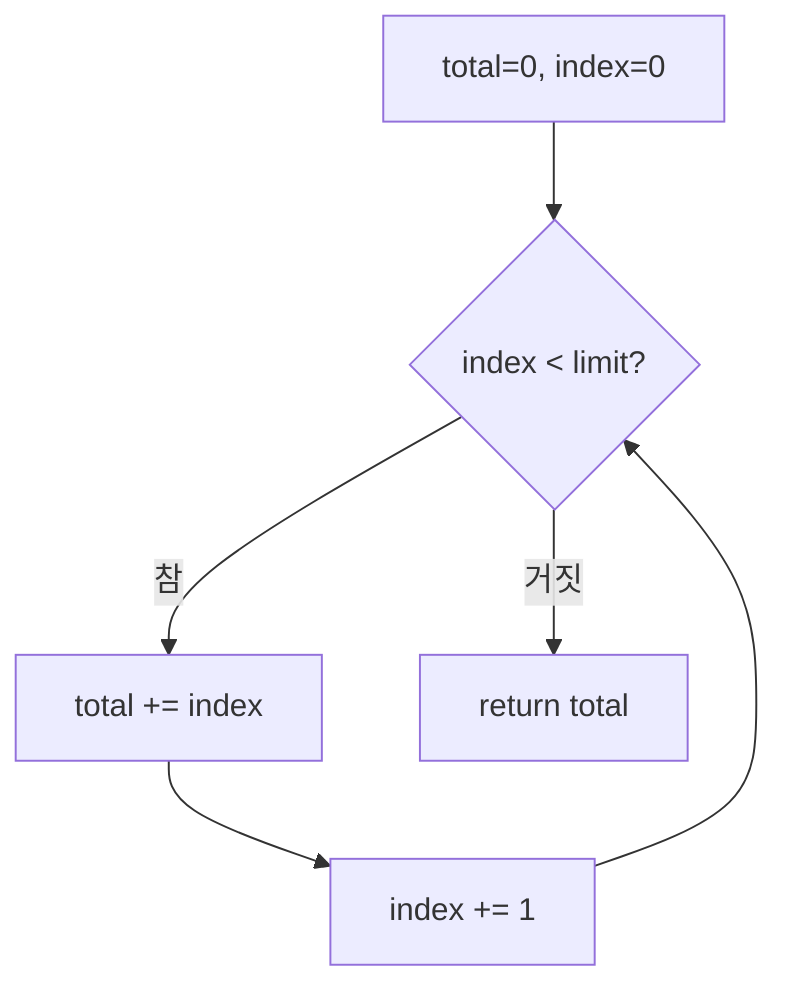

# 3주차: x86-64 명령어와 제어 흐름

[이전: 2주차](week-02.md) · [12주 커리큘럼](curriculum.md) · [다음: 4주차](week-04.md)

이번 주 목표는 **명령이 바꾸는 값과 분기가 선택하는 다음 위치**를 추적하는 것입니다. [03_flow.c](../../examples/reverse_engineering/03_flow.c)와 [registers.S](../../examples/reverse_engineering/registers.S)를 사용합니다. x86-64의 Intel 문법만 다룹니다.

## 1. 학습 순서와 시간

| 단계 | 시간 | 결과 |
|---|---|---|
| 레지스터·명령어 | 1.5시간 | 명령의 입력·출력·메모리 접근 구분 |
| C와 디스어셈블 대응 | 1.5시간 | 산술·비교·비트 연산 위치 찾기 |
| GDB와 루프 추적 | 2시간 | 명령 전후 값과 분기 결과 기록 |
| 수정·보고서 | 2시간 | 세 함수 결과 예측, 제어 흐름 그림 작성 |

## 2. 먼저 읽을 개념

레지스터는 CPU가 계산에 쓰는 작은 저장 공간입니다. `rip`는 다음에 실행할 명령 위치, `rsp`는 스택 꼭대기 주소입니다. `rax`, `eax`, `ax`, `al`은 서로 독립된 변수가 아니라 같은 레지스터의 일부를 가리킵니다.

| 이름 | 범위 | 쓰기 효과 |
|---|---|---|
| `rax` | 64비트 전체 | 전체 값 변경 |
| `eax` | 하위 32비트 | 상위 32비트가 0이 됨 |
| `ax` | 하위 16비트 | 다른 비트 보존 |
| `al` | 하위 8비트 | 다른 비트 보존 |

Intel 문법은 보통 **목적지, 원본** 순서입니다. `mov eax, 7`은 `eax`에 7을 쓰고, `mov eax, DWORD PTR [rdi]`는 `rdi` 주소에서 4바이트를 읽습니다. 대괄호가 없는 레지스터 값과 대괄호로 표시된 메모리 접근을 구분합니다.

| 명령 | 읽는 방법 | 주의점 |
|---|---|---|
| `mov dst, src` | 값을 복사 | 데이터 폭 확인 |
| `lea dst, [식]` | 주소 식을 계산 | 해당 주소의 메모리를 읽지 않음 |
| `add`, `sub` | 덧셈·뺄셈 | 폭에 맞는 결과와 플래그 변화 |
| `and`, `or`, `xor` | 비트 마스크·합치기·반전 조합 | 논리 참/거짓 연산과 구분 |
| `shl`, `shr` | 비트 이동, `shr`은 0으로 채움 | 부호 전파 우측 이동은 `sar` |
| `cmp a, b` | `a-b`처럼 플래그 설정 | 차이를 목적지에 저장하지 않음 |
| `test a, b` | `a & b`처럼 플래그 설정 | 결과를 목적지에 저장하지 않음 |
| `jcc`, `jmp` | 조건 또는 무조건 이동 | 사용하는 플래그와 목표 주소 확인 |
| `call`, `ret` | 호출·복귀 | 스택의 반환 주소는 4주차에서 관찰 |

정확한 명령별 동작은 [Intel 명령어 참조, Volume 2](https://www.intel.com/content/www/us/en/developer/articles/technical/intel-sdm.html)를 기준으로 확인합니다. 모든 C 문장이 하나의 정해진 명령으로 번역되지는 않습니다.

## 3. 실습 A: C 결과를 먼저 계산하기

소스의 `main`을 실행하기 전에 아래 값을 계산합니다.

| 함수 | 입력 | 예측할 결과 |
|---|---|---|
| `add_bias` | 4, 5 | `4 + 5 + 3` |
| `choose_signed` | -1 | signed 비교 `-1 < 10` |
| `choose_unsigned` | `(unsigned int)-1` | unsigned 최댓값과 10 비교 |
| `sum_to` | 0, 1, 4 | `0`부터 `limit-1`까지 합 |
| `mix_bits` | `0x23` | 마스크 → XOR → 시프트 → OR |

```bash
make -C examples/reverse_engineering
./examples/reverse_engineering/build/03_flow
objdump -d -M intel --disassemble=add_bias examples/reverse_engineering/build/03_flow
objdump -d -M intel --disassemble=choose_signed examples/reverse_engineering/build/03_flow
objdump -d -M intel --disassemble=choose_unsigned examples/reverse_engineering/build/03_flow
objdump -d -M intel --disassemble=sum_to examples/reverse_engineering/build/03_flow
objdump -d -M intel --disassemble=mix_bits examples/reverse_engineering/build/03_flow
```

기대 출력:

```text
add_bias(4,5)=12
signed(-1)=1 unsigned(UINT_MAX)=0
sum_to(0)=0 sum_to(1)=0 sum_to(4)=6
mix_bits(0x23)=242
```

비트 계산은 `0x23 ^ 0x5a = 0x79`, 왼쪽 이동 후 `0xf2`, 우측 이동 값은 `0x2`, OR 결과는 `0xf2 = 242`입니다. 이번 함수는 `uint32_t`로 계산합니다.

`push rbp`, `mov rbp,rsp` 등 공통 진입부와 핵심 계산을 나눠 표시합니다. `endbr64`가 보이는 환경에서는 간접 분기 보호를 위한 진입 명령임을 메모하고, 산술의 일부로 해석하지 않습니다. 함수 인자 전달 규칙은 다음 주에 자세히 관찰합니다.

## 4. 실습 B: 부분 레지스터와 `lea`

컴파일러마다 다른 결과를 피하고 명령 효과에 집중하기 위해 이 실습만 짧은 수제 어셈블리를 사용합니다.

```bash
gdb -q ./examples/reverse_engineering/build/03_registers
```

```gdb
set disassembly-flavor intel
set disable-randomization off
break *register_demo
run
disassemble /r register_demo
set $original_pointer = $rdi
x/wx $rdi
stepi
print/x $rax
stepi
print/x $rax
stepi
print/x $rax
stepi
print/x $rcx
print $rcx - $original_pointer
stepi
print/x $rdx
continue
quit
```

`break *register_demo`의 `*`는 함수의 **첫 명령 주소**에서 멈추기 위한 표기입니다. 다음 상태는 각 명령을 실행한 직후의 값입니다.

| 실행한 명령 | 관찰값 | 해석 |
|---|---|---|
| `mov rax, -1` | `rax = 0xffffffffffffffff` | 64비트 전체 변경 |
| `mov eax, 0x12345678` | `rax = 0x0000000012345678` | 상위 32비트 0 |
| `mov al, 0x7f` | `rax = 0x000000001234567f` | 하위 8비트만 변경 |
| `lea rcx, [rdi + 4]` | `rcx = 원래 rdi + 4` | 주소 계산, 메모리 읽기 없음 |
| `mov edx, DWORD PTR [rdi]` | `rdx = 0x12345678` | 실제 4바이트 읽기 |

`rdi`가 가리키는 객체는 4바이트 하나입니다. `lea`로 그 다음 주소를 계산할 수 있지만 그 위치를 역참조하지 않습니다. 프로그램의 마지막 출력은 `register_demo=305419903`이며 이는 `0x1234567f`의 십진 표현입니다.

## 5. 실습 C: 비교·플래그·분기

`cmp a,b`는 뺄셈 결과에 따라 플래그를 설정합니다. ZF는 결과가 0인지, SF는 결과의 부호 비트, CF는 unsigned 뺄셈의 빌림, OF는 signed 오버플로와 관련됩니다.

| 비교 종류 | 작다 | 작거나 같다 | 크다 | 크거나 같다 |
|---|---|---|---|---|
| signed | `jl`: SF ≠ OF | `jle`: ZF=1 또는 SF ≠ OF | `jg`: ZF=0이고 SF=OF | `jge`: SF=OF |
| unsigned | `jb`: CF=1 | `jbe`: CF=1 또는 ZF=1 | `ja`: CF=0이고 ZF=0 | `jae`: CF=0 |

동일 비교의 같음/다름은 `je`/`jne`가 ZF를 사용합니다. `test eax,eax`는 0 판별에 흔히 쓰이며, `cmp`와 같은 뺄셈이라고 설명하면 안 됩니다.

`choose_signed`와 `choose_unsigned`에서 비교와 분기를 찾습니다. GCC가 `value < 10`을 `value <= 9`로 표현하거나 **거짓 경로로 점프하는 반대 조건**을 택할 수 있습니다. `setcc`로 0·1을 만들 수도 있으므로 특정 `jl`이 반드시 나와야 한다고 기대하지 않습니다.

```bash
gdb -q ./examples/reverse_engineering/build/03_flow
```

```gdb
set disassembly-flavor intel
set disable-randomization off
break choose_signed
run
disassemble /r choose_signed
display/i $pc
info registers eax edi eflags
```

`display/i $pc`가 보여 주는 다음 명령을 먼저 확인합니다. 기준 빌드(GCC 13.3, `-O0`)에서는 이름 중단점이 프롤로그 뒤에 잡혀 **이미 `cmp` 명령 위에** 멈춥니다. 다른 명령이면 `stepi`로 `cmp` 직전까지 갑니다. 이 시점의 `eflags`는 이전 명령들이 남긴 값이므로 비교 결과로 기록하지 않습니다. 피연산자 값을 기록한 뒤 `stepi` 한 번으로 `cmp`만 실행하고 `info registers eflags`, 다시 `stepi`로 분기를 실행한 직후의 `$pc`를 기록합니다. 디스어셈블에 나온 자기 주소를 사용합니다. 새 GDB 세션에서는 중단점을 `choose_unsigned`에 두고 `run`하여 unsigned 경로도 비교합니다. 두 호출의 순서는 `printf` 인자 평가 순서에 따라 달라질 수 있으므로 각각 새 실행에서 관찰합니다.

관찰표의 열은 `함수 / 명령 주소 / 명령 / 피연산자 값 / ZF·SF·CF·OF / 다음 PC / 선택한 반환값`으로 만듭니다. 최종 반환값은 각각 1과 0이어야 합니다.

기준 빌드에서 관찰한 예입니다. 두 함수 모두 `value < 10`을 `cmp DWORD PTR [rbp-0x4],0x9`와 **반대 조건의 분기**로 표현했습니다.

| 함수 | 비교 | `cmp` 직후 `eflags` | 분기 | 분기 조건 | 결과 |
|---|---|---|---|---|---|
| `choose_signed(-1)` | `0xffffffff - 9` | `0x286` (SF=1, ZF=0, CF=0, OF=0) | `jg` | ZF=0이고 SF=OF → 거짓, 이동 안 함 | `mov eax,0x1` → 1 |
| `choose_unsigned(UINT_MAX)` | `0xffffffff - 9` | `0x286` (SF=1, ZF=0, CF=0, OF=0) | `ja` | CF=0이고 ZF=0 → 참, 이동 | `mov eax,0x0` → 0 |

**같은 비트 패턴, 같은 플래그**인데 결과가 다릅니다. signedness는 `cmp`가 아니라 **뒤따르는 분기 명령**이 정합니다. `0x286`의 비트는 PF(2)·SF(7)·IF(9)이며, GDB는 `[ PF SF IF ]`처럼 켜진 플래그 이름을 함께 보여 줍니다.

## 6. 실습 D: 루프에서 제어 흐름 복원하기

`sum_to`에서 초기화·조건 검사·합산·증가·되돌아가는 분기를 찾습니다.



`limit=4`일 때 조건 검사 직전의 `(index,total)`은 `(0,0)`, `(1,0)`, `(2,1)`, `(3,3)`, `(4,6)`입니다. `limit=0`은 본문을 한 번도 실행하지 않습니다. 소스의 `for` 순서와 실제 기계어 배치 순서는 다를 수 있으므로 화살표를 따라갑니다.

새 GDB 세션에서 `break sum_to`, `run`으로 시작하고 `disassemble /r sum_to`와 `stepi`로 위 표를 확인합니다. 이 프로그램은 `sum_to`를 여러 번 호출하므로 현재 `limit`가 0·1·4 중 무엇인지 `print limit`로 확인합니다. C는 `printf` 인자의 평가 순서를 고정하지 않으므로 호출 순서를 문서 순서로 가정하지 않습니다.

## 7. 수정 과제와 제출물

1. `sum_to(5)` 결과를 예측하고 확인합니다. 이어서 조건을 `index <= limit`로 바꿨을 때 0·1·4의 결과를 비교합니다. 큰 최댓값은 이번 과제에서 다루지 않습니다.
2. 두 비교 함수에 각각 9·10·11을 넣어 경계를 확인합니다. signed에는 -1도 넣습니다.
3. `mix_bits`의 XOR 상수를 `0x5b`로 바꾸고 입력 0·`0x23`·`0xff`의 결과를 손으로 계산한 뒤 검증합니다.

제출물은 함수 3개 이상의 C/어셈블리 대응표, 레지스터 추적표, signed/unsigned 비교 근거, 루프 그림입니다.

- `lea`와 `mov ... [주소]`의 차이를 실제 값으로 보일 수 있는가?
- `eax` 쓰기와 `al` 쓰기의 차이를 설명할 수 있는가?
- 비교의 signedness를 분기와 자료형 근거로 설명할 수 있는가?
- C의 조건이 참일 때 이동하는 경로와 거짓일 때 이동하는 경로를 모두 그렸는가?

**확인 답:** `sum_to(5)`는 10, `<=`로 바꾼 뒤 0·1·4는 0·1·10입니다. 최종 숫자만 맞추지 말고 반복 횟수와 분기 근거도 기록합니다.
