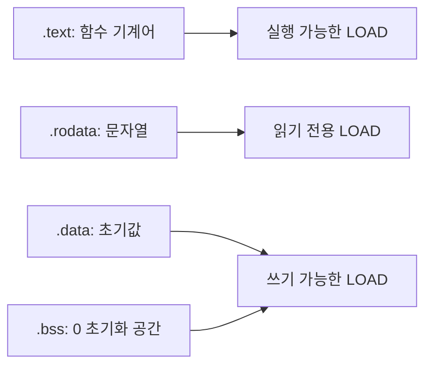

# 4주차: 함수 호출과 ELF

[이전: 3주차](week-03.md) · [12주 커리큘럼](../reverse-engineering.md) · [다음: 5주차](week-05.md)

이번 주 목표는 **호출 순간의 인자·반환값·스택**과 **실행 파일의 구조·주소**를 연결하는 것입니다. [04_elf.c](../../examples/reverse_engineering/04_elf.c)의 `main → compute → sum_seven`을 분석합니다.

## 1. 학습 순서와 시간

| 단계 | 시간 | 결과 |
|---|---|---|
| 호출 규약 개념 | 1시간 | 인자·반환값·반환 주소 구분 |
| GDB 호출 실습 | 2시간 | 함수 진입과 복귀 상태 기록 |
| ELF 조사 | 2시간 | 헤더·섹션·세그먼트·심볼 연결 |
| 주소 계산·보고서 | 2시간 | 파일 오프셋·정적 주소·실행 주소 구분 |

## 2. 먼저 읽을 개념: Linux 함수 호출 규약

호출 규약은 호출자와 피호출자가 인자 위치, 반환값 위치, 보존할 레지스터를 약속한 규칙입니다. 이번에는 **System V AMD64 ABI의 단순 정수·포인터 인자**를 사용합니다.

| 항목 | 이번 예제의 규칙 |
|---|---|
| 첫 여섯 정수·포인터 인자 | `rdi`, `rsi`, `rdx`, `rcx`, `r8`, `r9` |
| 일곱 번째 `long` 인자 | 함수 첫 명령에서 `[rsp+8]` |
| `long` 반환값 | `rax` |
| 반환 주소 | 함수 첫 명령에서 `[rsp]` |
| 피호출자가 보존할 범용 레지스터 | `rbx`, `rbp`, `r12`~`r15`, 복귀 시 `rsp` 복원 |
| 호출로 값이 바뀔 수 있는 범용 레지스터 | `rax`, `rcx`, `rdx`, `rsi`, `rdi`, `r8`~`r11` |

일반적인 `call`은 다음 명령의 주소를 스택에 넣고 호출 대상으로 이동합니다. `ret`은 그 주소를 꺼내 복귀합니다. 이번 정수 인자 예제에서는 호출 직전 `rsp`가 16바이트에 맞고, 반환 주소 8바이트가 추가된 함수 진입 시 `rsp % 16 == 8`입니다. 더 강한 정렬이 필요한 인자 종류는 이번 범위 밖입니다.

32비트 `int` 인자를 볼 때는 하위 레지스터 `edi` 등과 자료형을 확인합니다. 이번 4주차 예제는 `long`을 사용하므로 기준 환경에서 64비트 전체로 관찰할 수 있습니다. 부동소수점·구조체·가변 인자·시스템 콜·Windows x64는 이 표를 그대로 적용하지 않습니다. 세부 규칙은 [x86-64 psABI의 저수준 규칙](https://gitlab.com/x86-psABIs/x86-64-ABI/-/blob/master/x86-64-ABI/low-level-sys-info.tex)을 참고합니다.

## 3. 실습 A: 함수 첫 명령에서 상태 확인

```bash
make -C examples/reverse_engineering
./examples/reverse_engineering/build/04_elf
gdb -q ./examples/reverse_engineering/build/04_elf
```

프로그램 출력은 `elf-lab result=35 zeroed[0]=28`입니다. GDB에서는 다음을 실행합니다.

```gdb
set pagination off
set disassembly-flavor intel
set disable-randomization off
break *sum_seven
run
disassemble /r sum_seven
info registers rdi rsi rdx rcx r8 r9 rsp rbp
x/2gx $rsp
print/d *(long *)($rsp + 8)
print/x ((unsigned long)$rsp & 15)
set $return_pc = *(unsigned long *)$rsp
set $entry_sp = $rsp
x/i $return_pc
bt
```

첫 여섯 레지스터는 1·2·3·4·5·6, `[rsp+8]`의 `long`은 7이어야 합니다. `$rsp & 15`는 8입니다. `[rsp]`의 값은 `compute` 안의 `call sum_seven` 다음 명령 주소입니다.

```text
높은 주소
진입 rsp + 8 : 일곱 번째 인자 7
진입 rsp     : compute로 돌아갈 반환 주소
낮은 주소     : 이후 push·지역 공간 확보에 사용할 방향
```

첫 명령에서 멈추면 GDB가 `sum_seven (a=140726437051518, b=..., g=7)`처럼 엉뚱한 인자 값을 보여 줄 수 있습니다. 디버그 정보는 `-O0` 빌드의 인자 위치를 프롤로그가 저장할 `[rbp-...]`로 기록하는데, 첫 명령에서는 아직 `rbp`도 저장도 준비되지 않았기 때문입니다. 스택으로 전달된 `g`만 맞게 보일 수 있습니다. 이 시점에는 **레지스터와 `[rsp]` 기준 값**을 기록합니다.

여기서 `break sum_seven`과 `break *sum_seven`은 같은 관찰 위치라고 가정하지 않습니다. 이름 중단점은 프롤로그 뒤 소스 줄에 잡힐 수 있습니다. `[rsp+8]` 규칙은 함수 첫 명령에서만 그대로 사용합니다. `push rbp`와 `mov rbp,rsp`를 지난 뒤에는 이번 전형적 프레임에서 같은 일곱 번째 인자가 `[rbp+16]`에 보입니다. 실제 명령을 확인하고 기준 레지스터를 기록합니다.

이제 복귀를 확인합니다.

```gdb
finish
print/d $rax
print/x $pc
print $pc == $return_pc
print $rsp == $entry_sp + 8
disassemble /r compute
finish
print/d $rax
continue
quit
```

첫 반환값은 28, 다음은 전역 `initialized`의 7을 더한 35입니다. 첫 `finish` 직후 PC는 저장한 반환 주소, `rsp`는 진입 때보다 8 커야 합니다. 호출자가 스택 인자 공간을 정리하는 명령은 그 다음에 실행될 수 있습니다.

| 관찰 순간 | 인자 / 반환값 | PC의 의미 | 스택의 의미 |
|---|---|---|---|
| `sum_seven` 첫 명령 | 인자 1~7 | 피호출자 진입 | 반환 주소 + 스택 인자 |
| 첫 `finish` 직후 | `rax=28` | `compute`의 호출 다음 명령 | 반환 주소를 꺼낸 상태 |
| 두 번째 `finish` 직후 | `rax=35` | `main`의 호출 다음 명령 | `compute` 호출에서 복귀 |

## 4. 실습 B: ELF를 네 관점으로 읽기

```bash
file examples/reverse_engineering/build/04_elf
readelf -hW examples/reverse_engineering/build/04_elf
readelf -SW examples/reverse_engineering/build/04_elf
readelf -lW examples/reverse_engineering/build/04_elf
readelf -sW examples/reverse_engineering/build/04_elf
```

| 명령 | 질문 | 기록할 항목 |
|---|---|---|
| `-h` | 어떤 파일인가? 어디서 시작하는가? | ELF64, little-endian, x86-64, 타입, Entry point |
| `-S` | 코드·데이터·메타데이터는 어떻게 나뉘는가? | 섹션 이름, Type, Address, Offset, Size, Flags |
| `-l` | 로더가 무엇을 메모리에 배치하는가? | `LOAD`의 Offset, VirtAddr, FileSiz, MemSiz, Flags |
| `-s` | 어떤 이름이 어떤 위치·크기를 뜻하는가? | `main`, `sum_seven`, `message`, `initialized`, `zeroed`의 Value·Size·Ndx |

각 옵션의 의미는 [GNU readelf 공식 문서](https://sourceware.org/binutils/docs/binutils/readelf.html)를 참고합니다. `-W`는 긴 줄을 덜 잘리게 표시합니다.

다음은 이 예제에서 확인할 섹션입니다. 심볼의 `Ndx`와 섹션 번호를 연결해 실제 배치를 검증합니다.

| 섹션 | 예제 대상 | 파일의 내용 | 실행 시 의미 |
|---|---|---|---|
| `.text` | `sum_seven`, `compute`, `main` | 기계어 있음 | 보통 읽기·실행 가능 |
| `.rodata` | `message`와 출력 형식 | 바이트 있음 | 보통 읽기 전용 |
| `.data` | `initialized = 7` | 초기값 바이트 있음 | 수정 가능한 데이터 |
| `.bss` | `zeroed[4]` | `NOBITS`, 대상 데이터 바이트 없음 | 시작 시 0으로 채울 메모리 |

`.bss` 헤더의 Offset을 보고 그 위치에 `zeroed`의 초기 바이트가 파일에 저장돼 있다고 해석하면 안 됩니다. 정적 저장 기간의 0 초기화 객체를 파일의 0바이트 배열로 저장하지 않고 메모리 크기로 표현할 수 있습니다. 정의는 [ELF 섹션 명세](https://gabi.xinuos.com/elf/03-sheader.html)에 있습니다.

섹션은 링크·분석을 위한 구분이고, 세그먼트는 로딩 관점입니다. 하나의 `LOAD`에 여러 섹션이 들어갈 수 있습니다. `readelf -lW`의 마지막 `Section to Segment mapping`에서 대응을 그립니다. `FileSiz`와 `MemSiz`가 다른 쓰기 가능한 `LOAD`를 찾아 `.bss`와 연결합니다. 로딩 규칙은 [ELF 프로그램 헤더 명세](https://gabi.xinuos.com/elf/07-pheader.html)를 참고합니다.



이 그림은 전형적인 배치를 요약한 것입니다. 실제 `LOAD` 개수와 포함 관계는 자신의 빌드 결과를 기준으로 완성합니다.

## 5. 실습 C: ELF 진입점과 `main`

`readelf -hW`의 Entry point와 `readelf -sW`의 `main` 값을 비교합니다. 제공 빌드는 C 런타임의 시작 코드 `_start`를 거쳐 `main`을 호출하므로 두 값이 다릅니다. 동적 링크 환경에서는 인터프리터인 동적 로더의 초기화도 관여합니다.

```bash
objdump -d -M intel --disassemble=_start examples/reverse_engineering/build/04_elf
readelf -hW examples/reverse_engineering/build/04_elf_nopie
./examples/reverse_engineering/build/04_elf_nopie
```

PIE 비교본은 `DYN`, non-PIE 비교본은 `EXEC`이며 동작은 같습니다. 이것을 프로그램 동작 차이로 설명하지 않습니다.

## 6. 실습 D: 파일 오프셋·정적 주소·실행 주소

세 숫자를 구분합니다.

| 이름 | 기준 | 확인 도구 |
|---|---|---|
| 파일 오프셋 | 파일 시작부터 바이트 수 | `readelf -S`, `-l`, 파일 덤프 |
| 정적 가상 주소 | ELF에 기록된 링크 시 주소 | `readelf -s`, `objdump` |
| 실행 가상 주소 | 프로세스에 실제 매핑된 위치 | GDB의 심볼 주소, 매핑 |

GDB에서 PIE의 주소를 확인합니다.

```bash
gdb -q ./examples/reverse_engineering/build/04_elf
```

```gdb
set disable-randomization off
start
print/x &main
print/x &message
print/x &initialized
print/x &zeroed
info proc mappings
quit
```

두 번 새로 실행해 `&main`을 비교합니다. ASLR이 적용되면 PIE의 실행 주소가 달라질 수 있습니다. 주소가 같다면 시스템의 ASLR 설정과 GDB 설정을 확인하고 관찰 그대로 적습니다. non-PIE에서도 같은 절차를 반복합니다. 주 실행 파일의 주소가 고정돼도 스택·라이브러리까지 모두 고정되는 것은 아닙니다.

보통의 PIE에 대해 같은 실행 파일의 심볼 `main`으로 구한 `로드 바이어스 = 실행 주소 - 정적 가상 주소`를 다른 심볼에도 적용해 봅니다. 이어서 `message`의 정적 가상 주소가 들어 있는 `PT_LOAD`를 고릅니다. **파일에 저장된 범위**에서만 아래 계산을 적용합니다.

```text
정적 가상 주소 = 실행 가상 주소 - 로드 바이어스
파일 오프셋 = p_offset + (정적 가상 주소 - p_vaddr)
조건: p_vaddr <= 정적 가상 주소 < p_vaddr + p_filesz
```

숫자 연습: `p_offset=0x2000`, `p_vaddr=0x3000`, 대상 정적 주소가 `0x3020`이면 오프셋은 `0x2020`입니다. 이 숫자는 계산용이며 예제의 실제 주소가 아닙니다. `.bss`처럼 메모리에만 존재하는 범위에 이 공식을 적용하지 않습니다.

자신의 `message`에 대해 계산한 **오프셋을 십진 정수로** 아래 명령의 인자로 전달합니다.

```bash
python3 - examples/reverse_engineering/build/04_elf 8224 <<'PY'
import sys
with open(sys.argv[1], 'rb') as binary:
    binary.seek(int(sys.argv[2]))
    print(binary.read(8))
PY
```

위 `8224`는 숫자 연습의 `0x2020`을 십진수로 쓴 자리표시자입니다. **반드시 자기 계산값으로 바꿔 실행**합니다. 기대 바이트는 `b'elf-lab\x00'`입니다. 주소 값을 `seek`에 그대로 넣지 않았는지 확인합니다.

## 7. 수정 과제와 제출물

1. `sum_seven`의 마지막 인자를 7에서 70으로 바꿉니다. 일곱 번째 인자 위치에서 70을 확인하고, 합 91·최종 반환값 98을 검증합니다.
2. `zeroed[4]`를 `zeroed[1024]`로 바꿉니다. `.bss` 크기와 해당 `LOAD`의 `MemSiz` 증가를 확인합니다. 파일 전체 크기는 정렬·메타데이터의 영향을 받으므로 항상 완전히 같아야 한다고 주장하지 않습니다.
3. `message`의 실제 파일 오프셋을 계산하고 파일 바이트와 GDB의 `x/s &message`를 비교합니다.

제출물은 세 시점의 호출 상태표, 네 섹션의 심볼·주소·오프셋·크기 지도, 섹션/세그먼트 대응, `message`의 주소 변환 계산, PIE/non-PIE 비교입니다.

- 반환값과 반환 주소를 각각 다른 장소에서 관찰했는가?
- 일곱 번째 인자의 위치를 프롤로그 실행 전후로 구분했는가?
- `.bss`가 메모리를 차지하면서 파일에 해당 데이터 바이트가 없는 이유를 설명할 수 있는가?
- ELF 진입점과 `main`, 파일 오프셋과 실행 주소를 구분할 수 있는가?

**완료 기준:** 다른 사람이 보고서의 명령을 따라 같은 값의 관계와 바이트를 확인할 수 있으면 통과입니다. 이후에는 이 근거를 [5주차](week-05.md)에서 Ghidra의 함수·참조·디컴파일 결과와 연결합니다.
