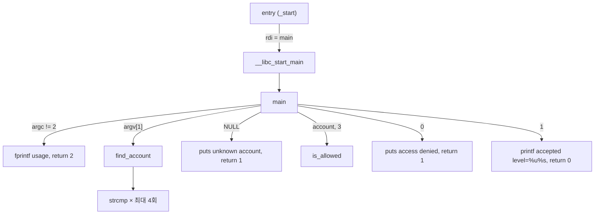

# 5주차: Ghidra 정적 분석

[이전: 4주차](week-04.md) · [12주 커리큘럼](curriculum.md) · [다음: 6주차](week-06.md)

이번 주 목표는 **실행하지 않고 문자열·참조·분기·데이터 접근만으로 함수의 역할을 추론**하고, 그 근거를 주소로 남기는 것입니다. 대상은 [05_lookup.c](../../examples/reverse_engineering/05_lookup.c)를 빌드한 `05_lookup_stripped`입니다. **소스는 7절의 대조 단계 전까지 열지 않습니다.**

이번 주에 세운 가설은 6주차에 GDB로 검증합니다. 그래서 결론만 적지 말고 "무엇을 보면 확인되는가"까지 적습니다.

## 1. 학습 순서와 시간

| 단계 | 시간 | 결과 |
|---|---|---|
| Ghidra 준비·가져오기 | 1시간 | 프로젝트, 자동 분석, 이미지 베이스 확인 |
| 문자열에서 출발하기 | 1.5시간 | 출력 문자열 → 참조 → 분기 → 호출 함수 연결 |
| 이름·자료형 복원 | 2시간 | 함수 3개 이름, 구조체 1개, 배열 1개 정의 |
| CLI 대조·보고서 | 1.5시간 | Listing과 `objdump` 근거 대조, 가설 3개 작성 |

## 2. 먼저 읽을 개념

정적 분석은 프로그램을 실행하지 않고 파일의 바이트를 해석하는 분석입니다. Ghidra는 디스어셈블과 함께 **참조(XREF)**, 함수 경계, 자료형 추정, 디컴파일 결과를 만들어 줍니다. 이 결과는 모두 분석기의 추론입니다.

| Ghidra 화면 | 보여 주는 것 | 사실로 볼 수 있는 범위 |
|---|---|---|
| Listing | 주소·바이트·명령어·데이터 정의 | 명령어 바이트와 해석은 확인 가능. 데이터 정의는 분석자가 바꿀 수 있음 |
| Decompile | C 비슷한 의사 코드 | 흐름 요약. 변수명·자료형·루프 형태는 추정 |
| Defined Strings | 문자열로 판단된 바이트 | 문자열 바이트는 사실. 그것이 쓰이는지는 참조로 확인 |
| XREF / References | 어떤 명령이 이 주소를 읽거나 부르는가 | 자동 분석이 찾은 직접 참조. 계산된 간접 참조는 빠질 수 있음 |
| Symbol Tree / Functions | 함수 목록과 이름 | strip된 파일에서는 `FUN_주소` 같은 자동 이름 |

디컴파일러가 보여 주는 `uVar1`, `local_10`, `undefined8` 같은 이름은 **원래 소스의 정보가 아닙니다**. 보고서에서는 "Listing `0x...`의 `cmp ...; jbe ...`에 근거해 `index < 4` 루프로 해석했다"처럼 명령어 근거를 함께 적습니다.

### strip이 지우는 것과 남기는 것

`strip`은 디버그 정보와 정적 심볼 테이블(`.symtab`)을 제거합니다. 코드·문자열·데이터의 바이트와 주소는 그대로 남고, 동적 링크에 필요한 외부 함수 이름(`strcmp`, `puts` 등)도 남습니다. 이번 대상은 strip 전후 `.text` 주소가 같으므로 디버그 빌드에서 나중에 답을 대조할 수 있습니다.

```bash
make -C examples/reverse_engineering
cd examples/reverse_engineering/build
file 05_lookup 05_lookup_stripped
readelf -sW 05_lookup | grep -E 'find_account|is_allowed|accounts|main'
readelf -sW 05_lookup_stripped | grep -E 'find_account|is_allowed|accounts' || echo "로컬 심볼 없음"
readelf --dyn-syms -W 05_lookup_stripped | grep -E 'strcmp|puts|printf'
```

`file`은 strip 버전에 `stripped`, 디버그 버전에 `with debug_info, not stripped`를 표시합니다.

## 3. 실습 A: Ghidra 프로젝트와 이미지 베이스

Ghidra를 [공식 설치 안내](https://github.com/NationalSecurityAgency/ghidra#install)대로 설치하고 실행합니다.

1. **File → New Project → Non-Shared Project**로 `re-week05` 프로젝트를 만듭니다.
2. **File → Import File**로 `examples/reverse_engineering/build/05_lookup_stripped`를 가져옵니다.
3. 가져오기 창의 Format이 `Executable and Linking Format (ELF)`, Language가 `x86:LE:64:default:gcc` 계열인지 확인합니다. 4주차의 `readelf -h` 결과(ELF64, little-endian, x86-64)와 비교합니다.
4. 파일을 열어 자동 분석을 묻는 창에서 기본 옵션으로 분석합니다.
5. **Window → Memory Map**에서 이미지 베이스와 `.text`, `.rodata`, `.data.rel.ro`, `.bss`의 시작 주소를 기록합니다.

PIE 실행 파일은 ELF에 기록된 정적 주소가 0 근처에서 시작합니다. Ghidra는 이런 파일을 보통 **이미지 베이스 `0x100000`** 위에 올려 보여 줍니다. 즉 `readelf`의 `0x12b1`이 Ghidra에서는 `0x1012b1`로 보일 수 있습니다. 자신의 Memory Map에서 확인한 값을 기준으로 다음 식을 기록합니다.

```text
Ghidra 주소 = Ghidra 이미지 베이스 + ELF 정적 가상 주소
실행 주소   = 실행 시 로드 베이스   + ELF 정적 가상 주소   (6주차에서 사용)
```

이 관계를 적어 두면 Ghidra, `objdump`, GDB의 주소를 서로 옮길 수 있습니다. Ghidra의 이미지 베이스를 0으로 바꾸는 것도 가능하지만, 이번 주에는 바꾸지 않고 변환식을 사용합니다.

## 4. 실습 B: 문자열에서 판정 경로 찾기

먼저 실행 결과를 관찰합니다. 이것은 정적 분석의 질문을 정하는 단계입니다.

```bash
cd examples/reverse_engineering/build
for name in guest analyst retired root nobody; do
  printf '%-8s ' "$name"; ./05_lookup_stripped "$name"; echo "  exit=$?"
done
./05_lookup_stripped; echo "exit=$?"
strings -a 05_lookup_stripped | grep -E 'accepted|denied|unknown|usage|guest|root'
```

출력은 세 종류의 판정(`accepted level=...`, `access denied`, `unknown account`)과 사용법 오류로 나뉩니다. 질문은 **"어떤 조건이 세 판정을 가르는가?"**입니다.

Ghidra에서 다음 순서로 진행합니다.

1. **Window → Defined Strings**에서 `accepted`를 필터링합니다. 형식 문자열 `accepted level=%u%s\n`을 더블클릭해 Listing으로 이동합니다.
2. 문자열 옆의 `XREF[1]: FUN_...:...`를 더블클릭하거나 주소를 선택하고 **References → Show References to Address**로 참조 명령을 찾습니다.
3. 도착한 함수가 `main`입니다. strip된 파일에서는 `FUN_0010125b`처럼 보일 수 있습니다. 이름을 `main`으로 바꿉니다(기본 단축키 `L`).
4. 같은 함수 안에서 `access denied`, `unknown account`, `usage: %s NAME` 참조도 찾고, 각 문자열을 `puts`/`printf`/`fprintf`에 넘기기 직전의 분기를 표시합니다.

`main`이 정말 `main`인지는 진입점에서도 확인합니다. **Symbol Tree → Functions → entry**를 열면 `__libc_start_main`을 호출하기 직전에 첫 인자 레지스터 `rdi`에 함수 주소를 넣는 `lea rdi,[...]`가 있습니다. 4주차에 배운 대로 ELF 진입점(`entry`, 원래 `_start`)과 `main`은 다릅니다.

`main`의 Listing에서 찾을 구조는 다음과 같습니다. 주소와 레지스터는 자기 화면 기준으로 적습니다.

```text
cmp  DWORD PTR [rbp-0x14],0x2      ; argc == 2 ?
je   ...                           ; 아니면 usage 출력, 반환 2
...
call FUN_A                         ; argv[1]을 rdi로 전달
mov  QWORD PTR [rbp-0x8],rax       ; 반환값(포인터 크기) 저장
cmp  QWORD PTR [rbp-0x8],0x0       ; NULL 인가?
jne  ...                           ; NULL이면 "unknown account", 반환 1
...
mov  esi,0x3                       ; 두 번째 인자 3
call FUN_B                         ; 첫 인자: FUN_A의 반환값
test eax,eax
jne  ...                           ; 0이면 "access denied", 반환 1
...
mov  eax,DWORD PTR [rax+0xc]       ; FUN_A가 돌려준 객체의 +12 위치 4바이트
and  eax,0x4                       ; 비트 2 검사 → " admin" 문자열 선택
...
mov  ecx,DWORD PTR [rdx+0x8]       ; 같은 객체의 +8 위치 4바이트 → printf의 %u
```

여기서 얻는 사실: `FUN_A`는 문자열 하나를 받아 **포인터 또는 NULL**을 돌려주고, `FUN_B`는 그 포인터와 상수 3을 받아 **참/거짓**을 돌려줍니다. 반환 객체에는 `+8`(출력되는 level)과 `+12`(비트 검사 대상) 필드가 있습니다.

## 5. 실습 C: 함수와 자료형 복원

### `FUN_A`: 테이블 검색

`FUN_A`로 이동해 Listing과 Decompile을 나란히 봅니다. 찾을 근거는 다음과 같습니다.

| 관찰 | Listing 근거 | 해석 |
|---|---|---|
| 루프 변수 | `QWORD PTR [rbp-0x8]`를 0으로 초기화, `add ...,0x1` | 8바이트 인덱스(`size_t`로 추정) |
| 종료 조건 | `cmp QWORD PTR [rbp-0x8],0x3` 다음 `jbe` | unsigned `index <= 3`, 즉 `index < 4` |
| 원소 크기 | `shl rax,0x4` | 인덱스 × 16 → 원소 하나가 16바이트 |
| 테이블 시작 | `lea rax,[rip+...]`의 대상 `DAT_...` | `.data.rel.ro`의 배열 |
| 비교 | 원소 `+0`의 8바이트를 `rdi`, 인자를 `rsi`로 `strcmp` 호출 | 원소 첫 필드는 문자열 포인터 |
| 성공 반환 | `strcmp` 결과가 0이면 `테이블 + index*16` 반환 | 일치한 원소의 주소 |
| 실패 반환 | 루프를 빠져나오면 `mov eax,0x0` | NULL |
| 전역 증가 | 루프마다 `.bss`의 4바이트 값 `+1` | 비교 횟수 카운터로 추정 |

이 함수에 `find_account`, 전역 카운터에 `lookup_count`라는 이름을 붙입니다. 이름은 역할을 기억하기 위한 분석자의 선택입니다. 소스의 이름과 같을 필요는 없습니다.

`index <= 3`처럼 소스와 다른 비교가 나온 것은 컴파일러가 같은 의미의 조건으로 바꾼 결과입니다. 3주차에서 본 것처럼 `<`가 반드시 `jl`/`jb`로 나와야 한다고 기대하지 않습니다.

### 구조체 정의

원소 16바이트의 필드를 정리합니다.

| 오프셋 | 크기 | 근거 | 이름·자료형(분석자 선택) |
|---|---|---|---|
| +0 | 8 | `strcmp`의 인자로 사용 | `char *name` |
| +8 | 4 | `main`에서 `%u`로 출력, `FUN_B`에서 3과 비교 | `uint level` |
| +12 | 4 | `and ...,0x1`, `and ...,0x4` 비트 검사 | `uint flags` |

1. **Window → Data Type Manager**에서 현재 프로그램 이름의 데이터 타입 아카이브를 오른쪽 클릭하고 **New → Structure**를 선택합니다.
2. 이름을 `account`로 하고 위 표의 세 필드를 추가합니다. 크기가 16인지 확인합니다.
3. `find_account`가 참조한 테이블 주소로 이동해 기존 데이터 정의를 지우고(**Clear Code Bytes**), 자료형 `account`를 적용한 뒤 4개짜리 배열로 만듭니다(**Data → Create Array**). 이름은 `accounts`로 바꿉니다.
4. `find_account`의 반환형과 `main`의 지역 변수형을 `account *`로 바꿉니다(Decompile 창에서 기본 단축키 `Ctrl+L`, 함수 서명은 오른쪽 클릭 → **Edit Function Signature**).

자료형을 적용하면 Decompile 결과의 `*(long *)(param + 8)` 같은 식이 `account->level`처럼 바뀝니다. 바뀐 결과가 Listing의 오프셋과 맞는지 다시 확인합니다.

배열의 네 원소를 표로 남깁니다. Ghidra가 `name` 필드를 문자열 포인터로 표시하면 대상 문자열을 함께 적습니다.

| 인덱스 | name | level | flags | 비트 0 | 비트 2 |
|---|---|---|---|---|---|
| 0 | | | | | |
| 1 | | | | | |
| 2 | | | | | |
| 3 | | | | | |

### 재배치와 파일 바이트

PIE에서 테이블 안의 문자열 포인터는 실행 시 로드 베이스에 따라 달라집니다. 그래서 이 테이블은 `.data.rel.ro`에 있고, 로더가 `R_X86_64_RELATIVE` 재배치로 값을 고칩니다. 파일 바이트와 재배치 정보를 직접 확인합니다.

```bash
cd examples/reverse_engineering/build
readelf -SW 05_lookup_stripped | grep -E 'rodata|data.rel.ro'
objdump -s -j .data.rel.ro 05_lookup_stripped
readelf -rW 05_lookup_stripped | grep RELATIVE
objdump -s -j .rodata 05_lookup_stripped
```

기준 환경(GCC 13.3, Binutils 2.42)에서는 `.data.rel.ro`의 16바이트 행마다 첫 8바이트가 `.rodata` 안 문자열의 정적 주소, 다음 두 4바이트가 level·flags였습니다. 재배치 항목의 Addend도 같은 정적 주소를 가리켰습니다. 링커·옵션에 따라 파일에 기록되는 값은 다를 수 있으므로, 자기 결과에서 **재배치 Addend → `.rodata` 문자열**로 연결합니다. Ghidra가 이 재배치를 반영해 보여 주는 포인터 값도 이미지 베이스 기준이라는 점을 확인합니다.

### `FUN_B`: 허용 판단

| 관찰 | 해석 |
|---|---|
| 인자 `+12`를 읽어 `and eax,0x1`, 0이면 `mov eax,0x0` 반환 | 비트 0이 꺼져 있으면 무조건 거부 |
| 인자 `+8`과 두 번째 인자를 `cmp`, `setae al` | unsigned `level >= required`의 결과 0/1 반환 |

`setae`는 unsigned 비교입니다(3주차의 `jae`와 같은 CF=0 조건). 이 함수에 `is_allowed`, 두 번째 인자에 `required`, 비트 0에 `FLAG_ACTIVE`(또는 자신이 정한 이름), 비트 2에 `FLAG_ADMIN`이라는 이름을 붙입니다.

## 6. 실습 D: 관계도·의사 코드·가설

**Window → Function Call Trees**에서 `main`의 Outgoing Calls를 펼치고, **Window → Function Graph**에서 `main`의 블록 흐름을 확인합니다. 그 결과로 관계도를 그립니다.



자기 분석에서 확인한 함수 주소를 노드 옆에 적습니다. 이 그림은 Function Call Trees의 결과를 그대로 옮긴 것이 아니라 **분기 조건까지 포함한 분석자의 요약**입니다.

의사 코드는 자신이 붙인 이름으로 작성합니다.

```text
main(argc, argv):
    if argc != 2: usage 출력, return 2
    account = find_account(argv[1])        ; 0x...: call
    if account == NULL: "unknown account", return 1
    if !is_allowed(account, 3): "access denied", return 1
    "accepted level=<account.level>" + (flags & 4 ? " admin" : "")
    return 0
```

이번 주 결과를 6주차 실행 관찰로 검증할 가설로 바꿉니다. 각 가설에 **확인할 주소와 기대값**을 붙입니다.

| 번호 | 가설 | 6주차 확인 방법 | 기대값 |
|---|---|---|---|
| H1 | 없는 이름이면 `find_account`가 NULL을 반환한다 | `find_account` 호출 다음 명령에서 `rax` | `nobody`일 때 0 |
| H2 | `retired`는 level이 충분해도 비트 0 때문에 거부된다 | `is_allowed`에서 읽는 `+8`, `+12`와 실행한 반환 경로 | level 5, flags 0, 조기 반환 0 |
| H3 | `find_account`는 테이블을 처음부터 순서대로 비교한다 | 전역 카운터 변화 횟수 | `guest` 1회, `root`·`nobody` 4회 |

## 7. 실습 E: Ghidra 없이 같은 근거 확인하기

Ghidra 화면은 버전과 설정에 따라 다르므로 핵심 근거는 CLI로도 남깁니다.

```bash
cd examples/reverse_engineering/build
objdump -d -M intel 05_lookup_stripped > lookup.asm
grep -nE 'strcmp|puts|printf|shl +rax,0x4|setae|and +eax,0x[14]' lookup.asm
```

strip된 파일의 `objdump`는 함수 이름 대신 `call 11a9 <fprintf@plt+0xf9>` 같은 라벨을 붙일 수 있습니다. 이것은 **가장 가까운 남은 심볼을 기준으로 한 표시**일 뿐이고, 호출 대상이 `fprintf`라는 뜻이 아닙니다. 대상 주소 `11a9`만 사용합니다.

마지막으로 디버그 빌드와 소스를 열어 대조합니다.

```bash
objdump -d -M intel --disassemble=find_account 05_lookup
objdump -d -M intel --disassemble=is_allowed 05_lookup
```

자신의 이름·자료형·가설이 소스와 다른 곳을 찾아 "Ghidra 결과를 사실로 받아들인 곳"과 "근거가 부족했던 곳"을 구분해 적습니다. 다르게 이름 붙인 것 자체는 오류가 아닙니다.

## 8. 수정 과제와 제출물

소스 수정은 복사본에서 진행합니다.

1. 테이블에 `{"auditor", 4U, FLAG_ACTIVE}`를 추가해 다시 빌드하고 strip합니다. Listing의 루프 종료 상수와 `.data.rel.ro` 크기가 어떻게 바뀌는지 예측한 뒤 확인합니다.
2. 구조체에 `unsigned char region` 필드를 `flags` 뒤에 추가합니다. 원소 크기와 `shl` 또는 곱셈 명령이 어떻게 바뀌는지 확인하고, 패딩을 2주차 근거로 설명합니다.
3. `REQUIRED_LEVEL`을 5로 바꾸면 각 이름의 결과가 어떻게 되는지 정적 분석만으로 예측하고 실행해 확인합니다.

제출물:

- 함수 관계도와 의사 코드. 모든 노드·분기에 Listing 주소
- 주소 변환식(ELF 정적 주소 ↔ Ghidra 주소)
- `account` 구조체 표와 배열 4원소 표, 재배치 근거
- 가설 H1~H3과 확인 방법
- 소스 대조 결과: 맞힌 것, 틀린 것, 근거가 부족했던 것

자가 점검:

- 디컴파일러의 변수명·자료형을 근거 없이 보고서에 옮기지 않았는가?
- `shl rax,0x4`, `+0x8`, `+0xc`를 구조체 크기와 필드 오프셋으로 연결했는가?
- strip된 파일의 `objdump` 라벨을 함수 이름으로 오해하지 않았는가?
- 문자열이 존재한다는 사실과 그 문자열이 판정 경로에서 사용된다는 사실을 참조로 구분했는가?

**완료 기준:** 다른 사람이 보고서의 주소만 따라가도 세 판정의 조건을 같은 명령어에서 확인할 수 있으면 통과입니다.

**확인 답:** 원소 크기 16, 필드 오프셋 0·8·12. `retired`는 level 5지만 flags 0이라 거부, `root`만 flags 비트 2가 켜져 ` admin`이 붙습니다. 수정 과제 3에서는 `root`만 수락됩니다(`retired`는 여전히 비트 0 때문에 거부).
